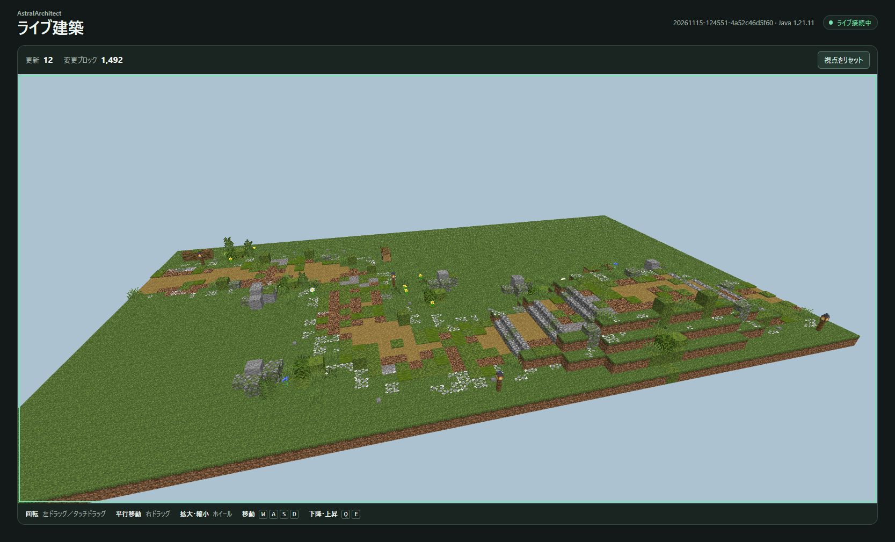

# 標準の自然な道

意匠プロファイル `AR-NATURAL-ROAD-01` / version 1.0 / 2026-11-15

## 適用する場面

この利用者の建築で道を新設・再設計するときは、本作例を既定のベースにする。道単体に加え、住宅・城・庭・集落の通路、入口へのアプローチ、橋の取り付け道も対象。道の作成自体が依頼に必要な場合に適用し、未依頼の道や外構を増やさない。

明示された別様式・材料・簡素さ、既存の道の意匠を保つ指定を優先する。舗装された都市の大通りなど別様式が指定された場合は土と苔へ変更しない。穴埋めなどの局所修理では、周囲の材料を保って修理範囲だけを扱う。様式指定のない新しい道では、毎回標準の採用可否を聞かず本作例から設計する。

## 承認済みの見た目

設計前に次の画像を実際に開く。配色だけでなく、土の余白、苔の厚み、植生や小物の大小と密度を見る。

- 元チケット: `20261115-124551-4a52c46d5f60`。採用候補のSHA-256は [作例記録](natural-road-example.json) に保持する。
- 利用者は、自然な土の道 → 苔・苔カーペット・緑色カーペットによる凹凸 → よりランダムな配置 → 道端の落ち葉 → 情報量の追加、の順に調整し、最終案を「完璧です。これで保存してください。」と承認。その後、この道を標準にするよう明示した。
- 画像は実際のブロック操作をJava 1.21.11の素材で描いたライブビューアーのキャプチャ。画像生成AIによる見本ではない。白っぽい散らばりは落ち葉の未対応の色付けであり、白い花・白いブロックで再現しない。
- 静的データと3D表示を確認した作例。実ゲームの歩行・ブロック更新・夜間光量の確認済み作例ではない。標準への採用は見た目と設計方針の承認であり、別チケットの検証の代わりにはならない。

## 引き継ぐ特徴

| 部位 | 既定の設計 |
|---|---|
| 路面 | `dirt_path` と `coarse_dirt` を中心に、小さな `gravel` のまとまりを混ぜる。土が続く筋と余白を残す。均等な石畳、色石の帯、幾何学的な模様へ戻さない |
| 苔と凹凸 | `moss_block` で地面の一部と道端の盛り上がりを作り、`moss_carpet` と `green_carpet` を厚み・緑の差に使う。歩行帯では主に薄いカーペット、1ブロックの盛り上がりは道端へ置く |
| 配置 | 大小の不規則な塊、途切れた帯、孤立した小片を混ぜる。等間隔、同じ大きさの丸、左右対称、同じ模様の繰り返しを避ける。苔で全面を覆わず土の余白をばらつかせる |
| 落ち葉 | `leaf_litter` を道端・苔の際に散らす。曲がり角の外側や岩・植生の脇は少し密にし、直線は疎な場所も残す。対応版では `facing` と `segment_amount=1..4` を変える |
| 岩・小石 | 苔むした丸石、安山岩、ハーフブロックで高さ・出幅の異なる岩を作る。床置きの石ボタンは小石の表現として使える。同形の岩を等間隔に並べない |
| 植生・倒木 | 草、シダ、低木、少量の野花、短い倒木を局所的に組み合わせる。倒木には横向きの原木や苔を使い、道へ向けて配置に意味を持たせる |
| 灯り | 必要な区間に小さな木の杭とランタン。豪華な石柱、連続する装飾柵、過剰な発光模様を既定にしない |
| 坂・接地 | 段差は丸石・苔むした丸石の階段と踊り場で処理し、側面を土と草の斜面につなぐ。平地へ見本の盛り土を無条件に追加しない |

道端の情報量は省略しない。遠景では曲がりと高低差、中景では岩・倒木・植生、近景では苔の厚み・小石・落ち葉が読めるように配分する。狭い場所では細部の数とサイズを減らして道幅を優先し、作例の個数をノルマにしない。

## 現地に合わせる設計

- 接続先、地面の高さ、保存する水・樹木・構造物を調べてから中心線と有効歩行帯を予約する。直線・左右の曲がり・上り・踊り場・下りで、路面の材料と端部の納まりをそろえる。
- 作例の歩行幅5、曲線半径8、3ブロックの上り下りは例であり、必須寸法ではない。幅・曲率・高さ・長さ・灯りや植生の密度は用途と地形から決める。直線だけで足りる場所に曲がりや坂を強制しない。
- 坂の階段は進行方向に合わせ、踊り場・土の路面と接続する。カーブの内側で歩行帯を狭めない。再利用する部品の端部は、幅・向き・路面高を一致させ、内部の継ぎ目に端止めを入れない。
- ランダム配置は、歩行帯・保存領域を除いた配置可能領域で行う。密度に偏りを作り、近接した塊と点在を混ぜ、プレビューで機械的な繰り返しを修正する。スクリプトを使う場合は再現できるseedを記録してよいが、作例と同じseedや比率を固定しない。
- 通路上の苔・カーペットも歩行床として扱う。`dirt_path` の高さ、カーペットや階段の実形状を考慮し、浮いたカーペット、砂利の支持欠損、1ブロックの歩行障害、頭上への植生侵入を確認する。落ち葉・カーペットは安定した支持面へ置き、階段の踏面には無理に載せない。
- 対象版のブロックとプロパティを確認する。非対応の落ち葉などは利用可能な自然素材へ読み替え、差分を報告する。ビューアーの簡略形状や未対応の色を実ゲームの見た目と混同しない。

## 実行と確認

作例の座標、旧操作ファイル、Schematicを新しいチケットへそのまま適用しない。実チケットの調査結果に基づき、新しい明示的な操作を作る。AstralArchitectでは従来どおり正規CLI、候補ハッシュ確認、ライブ案の書き出しと`apply-ops`を使い、ワールド適用はプレイヤーに残す。チケット外の建築データには、その作業の編集手順を使う。

確認時は「土が読める」「苔の厚みと疎密がある」「落ち葉と道端の細部が不規則にまとまる」「曲がり・坂でも道が途切れない」を画像と断面で見る。完成判定は [MC-BUILD-Q1](completion-standard.md) に従い、個別に求められた意匠と未検証のゲーム動作を分けて記録する。
