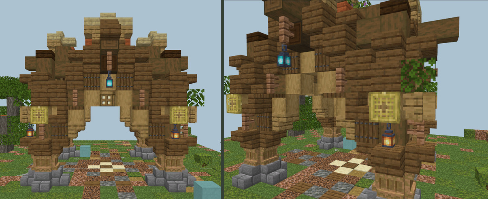

# 木造門の柱・梁・庇の装飾

作例 AR-TIMBER-GATE-01。ゲーム内に適用した門（チケット 20261124-092551-e3fbe1a2a682）を利用者が手直しし、南面を今後の設計の作例に指定した。画像は手直し後のチケット 20261124-105348-372a0417a01a の正本を3D表示して撮影したもの。左は南正面、右は柱と庇を斜めから見た寄り。正本のSHA-256は 10645f164d52cc099d0e2679c9726832e7d8397a656ecc7330096408cd936957。

## 画像とブロック状態から読む納まり

- 石レンガの階段で柱脚に段差をつけ、すぐ上をジャングルの棚で巻いて細い帯にする。幅のある石の土台から、木の柱へ段階的につなぐ。棚は今回の他面展開ではすでに共通部にあった。
- 横向きの原木は梁先の木口を見せ、細い腕木を添える。庇はトウヒの階段（通常・上付き、外角を含む）とハーフブロック（下付き・上付き・二重）を組み、柱の肩から開口中央へ一段ずつ高くする。斜視では中央の梁先が手前に張り出す様子も見える。
- トウヒのトラップドアは開いた状態を縦板に、閉じた状態を横向きの薄板に使い分ける。左右の肩には、開いた竹のトラップドアで明るい透かしを入れる。中央には柵で吊った青い魂のランタン、周辺には既存の暖色のランタンがあり、中央と両脇の見え方に差がつく。

## 別の建築で使う

木造門、木組みの玄関、庇や回廊の柱梁を設計するときに画像を開く。柱脚から肩・庇までの大きな輪郭を決め、肩のせり出しと梁先で中くらいのまとまりを作り、薄板・透かし・吊り元で細部をつなぐ。代表の一間を正面と斜め・見上げから確認し、段差、部材同士の接触、灯具と吊り元のつながりを見る。小さな門や用途の異なる建築では、通行幅と見える距離に合わせて素材・灯色・寸法・個数を調整する。

## 利用者が手直しした面を展開する

この作例では手直し済みの新チケット正本を旧適用版と比較して変更箇所を確認した。旧版がなければ同じ門の他面も比較に使う。見本面の追加、意図した空所や置換を、展開先の納まりに合わせて回す。全周の共通部や共有角は既存の納まりを使い、隣面の部材が重なる箇所では接続を確認する。この門では足元の地形を維持した。

他面へ反映した装飾は面ごとに32セル。各面にすでにある石レンガの基壇、ジャングルの棚（ブロックエンティティ）、共通の梁材はそのまま使った。庇の段差に重なる既存の葉2セルは、作例の輪郭に合わせてトウヒの二重ハーフブロックに置き換えた。

水平回転では座標に加え、水平の facing、軸の axis、柵などの四方向の接続フラグも回す。階段・ハーフの上下、扉板の開閉、階段外角の左右は維持する。鏡映を使う場合は左右が反転するため、回転とは区別する。元の座標や操作ファイルを別のチケットへ流用せず、AstralArchitectでは実チケットの調査結果に基づき、正規CLIと変更契約に従って候補を作る。
