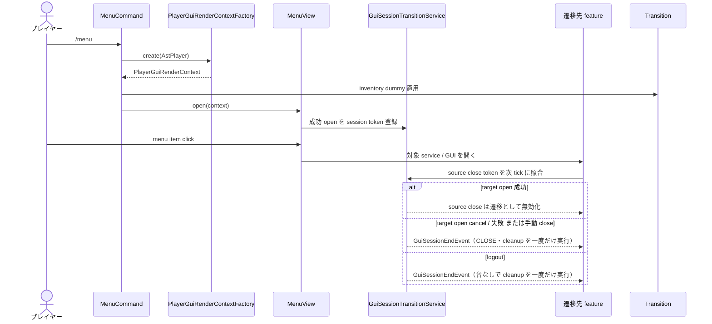
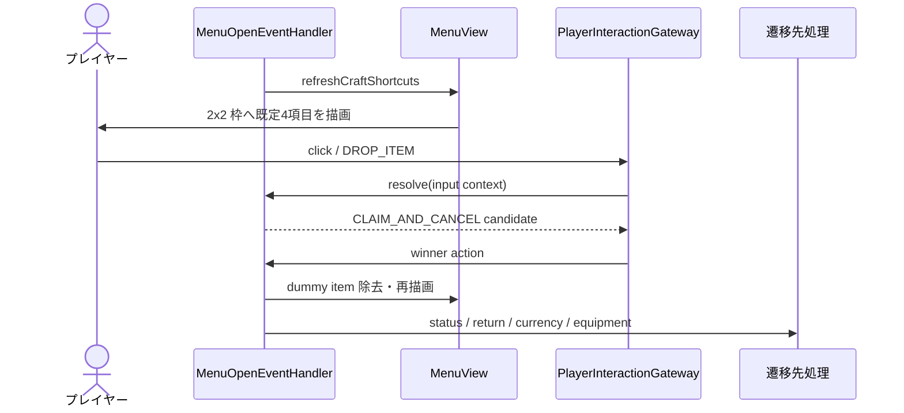
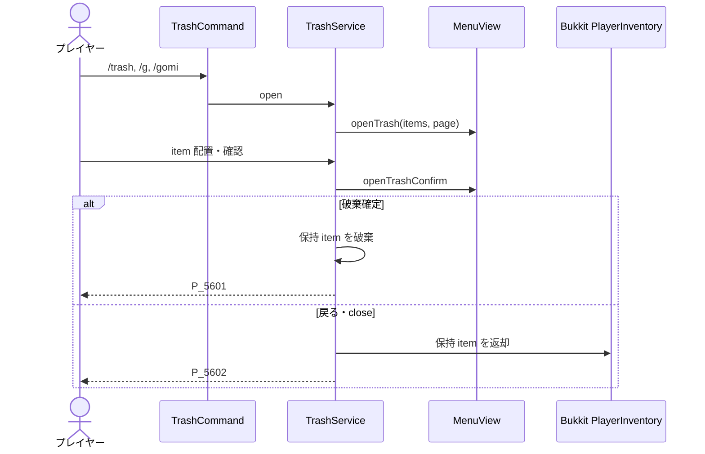

# 09_4-統合フロー

## 0. 参加時メニュー導線

プレイヤー参加時の非同期ロード中に、選択アカウントの CURRENCY インベントリから `99a00016` を確認する。未所持の場合は `20a00013` の装備インスタンスを準備し、メインスレッドで `20a00013` を先に通常インベントリへ追加し、その後 `99a00016` を CURRENCY インベントリへ追加する。通行証を所持している場合は追加処理を行わない。参加処理が中断・失敗した場合は、準備済みで未登録の装備インスタンスを削除する。

`20a00013` は `EQUIPMENT` の `TOOL` であり、共有タグ `MAIN_MENU` を持つ。共通入力 gateway は右クリックを検出すると、既存のメインメニュー表示へ委譲する。

## 1. メインメニュー表示・画面遷移

### シーケンス

メインメニューのクエスト項目（slot `24`）は`QuestGuiEventHandler.openList`へ切り替え、既存のクエスト一覧GUIで受領中クエストを表示する。クエスト一覧の項目クリックは`QuestService.abandon`へ委譲し、成功時に一覧を再描画する。

### 処理要点

- 画面は `MenuInventoryHolder.screen` で識別し、ページ・detail ID を holder へ保持する。
- 画面間遷移では session token で source close を評価する。遷移成功時は `CLOSE` と feature 固有 cleanup を実行せず、cancel・失敗・手動 close 時だけ終了を一度確定する。
- logout は active session を音なしで一度だけ終了し、ゴミ箱・売却・ストレージ・dummy inventory などの共通 cleanup を `GuiSessionEndEvent` へ委譲する。
- 業務処理は遷移先 feature へ委譲し、menu は表示と navigation に限定する。

### 例外・終了条件

- gameplay player でなければ menu を開かない。
- menu open の例外は `E_5600`、shared GUI 操作の例外は `E_5601`（`player`, `operation`）として記録し、Bukkit event loop へ送出しない。

## 2. クラフトショートカット

### シーケンス

### 処理要点

- shortcut は gameplay player にだけ表示し、現行値は `MenuShortcutSettings.defaults()` 固定とする。
- DROP 入力は player-interaction の勝者選択を経由する。
- spawn / pickup された shortcut marker item は削除し、world item 化を防ぐ。

### 例外・終了条件

- `CRAFTING` view でない場合は再描画しない。
- quit・world 変更・plugin disable では shortcut と一時状態を除去する。

## 3. ゴミ箱確定・返却

### シーケンス

### 処理要点

- 確認前の item は GUI が保持し、意図しない close では必ず返却する。
- page 移動と確認遷移でも保持 item を新しい inventory へ引き継ぐ。
- 確認画面から戻るときは item を返却した後、戻り先の編集画面を空状態へ再描画し、返却済み item を再び確認対象へ取り込まない。
- 戻り先の表示が取消・失敗した場合は、返却済み item を保持しない確認画面だけを閉じる。

### 例外・終了条件

- inventory に戻せない item はプレイヤー位置へ drop し、消失させない。
- content placeholder は item として扱わない。

## 4. ガイド進行と通知

- ガイド進行はアカウント単位の `(guideId, stepId)` 完了集合として保存する。条件に合致した手順だけを追加し、既に完了した手順は再通知しない。同じイベントが複数回届いても保存と通知は一回分にまとめる。
- 装備の耐久値が正の値から 0 になった時、`EQUIPMENT_BROKEN` を記録する。初回破損後は修理ガイドの次の手順をチャットで示す。破損前の修理ガイドは通常の次ガイド案内には選ばない。
- 手順達成時は残りの手順を、ガイド完了時は表示順で次の未完了ガイドの名前と最初の未完了手順をチャットで示す。操作詳細はガイド画面に置き、チャットは次の行動を短く伝える。全ガイド完了時は次ガイド案内を送らない。
- 定期的なガイド確認の促しは、進行の読み込みが済み、現在のマスターに未完了ガイドがあるアカウントだけに送る。マスターが空、進行が未ロード、全ガイド完了の場合は送らない。後日追加したガイドは、既存の完了集合を保持したまま未完了として扱う。
- ペットの孵化は魔法の卵を所持しただけでは達成しない。孵化操作が API とローカル状態へ確定した時だけ `PET_HATCHED`、孵化済みペットの追従実体が召喚された時だけ `PET_FOLLOW_STARTED` を記録する。

- 進行ロード待ちの破損イベントはログアウトで破棄され得る。次のログインで inventory/装備とガイド進行の両方を読み込んだ後、本人所有で最大耐久値があり現在耐久値 0 の装備を再照合する。破損手順が未達成の場合だけ通常の `recordCondition` に戻し、inventory とガイド進行を同じ player-state snapshot で保存する。古いログインの非同期結果はセッション照合で捨てる。ロード中イベントの主スレッド再生も、実行時にロード世代・進行キャッシュ・現在のプレイヤーセッションを確認し、退出後の古い通知を適用しない。
- `first_equipment_repair` の `repair_with_sindri` は `notice_broken_equipment` 達成後のシンドリのオーブ使用だけで達成する。破損前の部分修理は修理ガイドを先取りしない。チャットの次案内は見出しと手順本文に絞り、GUI 向けのクリック説明は流さない。
- 通常ログインやアカウント切替でも、ペット一覧の読み込み後に孵化済みペット（魔法の卵は除外）を `PET_HATCHED` へ再照合する。達成済みの手順は再通知しない。

## 5. ガイド全達成報酬

### 状態表示と再照会

- 通常の GET 通信失敗は読み取り失敗として扱い、取得済みの保存境界を解放する。GET 後の player-state 保存が失敗して境界が残った場合だけ、同じ操作 ID の recovery GET で確定する。回復 GET が失敗した間は境界を保持し、次の画面表示時に再照会する。

- ガイド進捗が読み込み済みで、少なくとも1件のガイドがあり、現在の全ガイドの全手順が完了したアカウントだけ報酬状態を照会する。未ロード、未完了、空のガイド集合は受取可能とみなさない。
- ガイド一覧を開いた時と、最後の未完了手順を達成した時に、`InventorySaveCoordinator.executeExclusiveAfterSave` で guideProgress の player-state snapshot 保存と ACK を確定してから API の報酬状態を取得する。Bukkit 主スレッドを通信で待たせない。最後の手順の直後でも保存後の結果で一覧を更新する。
- API の `configured && allCompleted && canClaim && !claimed` が成立する時だけ、ガイド一覧の受取ボタンを表示する。未設定、未完了、受取済み、取得失敗の時は報酬を受け取れると表示しない。受取可能になった案内は同じログインセッションで一度だけ送る。クリア済みガイドの通常案内や定期的なガイド促しとは区別する。
- ガイド一覧を開き直せば再照会できる。後日ガイドが追加されてローカルの全完了判定が false になれば古い受取可能表示を消す。API の受取済み記録は後日ガイド追加でも維持する。

### 受取と保存境界

- 受取リクエスト中に一覧を開き直した場合は、その受取結果まで再描画を待つ。同じアカウントの回復 GET を並行予約しない。
- POST 通信結果が不明でも報酬 API は player-state snapshot を直接変更しないため、通信例外を結果値として回収して保存境界を正常に閉じる。その後 GET で受取済みかを確認する。POST 後の player-state 保存が失敗して境界が残った場合は、同じ操作 ID の recovery GET で収束させる。他の取引の未解決境界は回復対象にしない。

- 報酬ボタンの同時クリックはアカウント単位で一つの受取操作にまとめる。受取前も同じ保存境界を通し、guideProgress の保存が失敗した場合は POST しない。
- POST は現在の user UUID を `updatedBy` として送る。API が現行ガイドの全完了と報酬設定を再判定し、受取済み記録と報酬メールを一度だけ作る。Plugin はアイテムを直接付与せず、メニューのメールから受け取るよう案内する。
- POST が成功した場合は受取可能表示を消す。既配布に対する冪等応答でも、メールを確認できる文言を使用する。409 の場合は再照会して現在受け取れない旨を伝える。通信結果が不明な場合は GET で受取済みを再確認し、既配布ならメールを案内し、確認できなければ再試行できる状態にする。

### セッション切替

- 旧セッションの遅延 callback は、新セッションで開始した回復照会の操作 ID を消去しない。回復 GET が失敗した場合は境界と操作 ID を保持し、次の一覧表示で同じ ID を使って再試行する。
- logout、アカウント復旧、再ログインで一時的な報酬状態と案内済み状態を破棄する。前のセッションの非同期応答は新しいセッションの表示、案内、照会待ち状態を変更しない。
