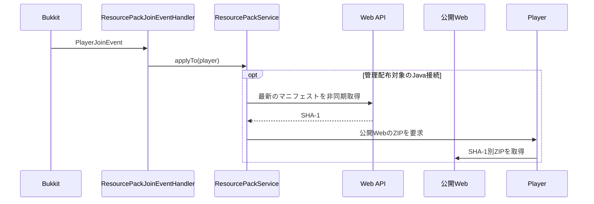
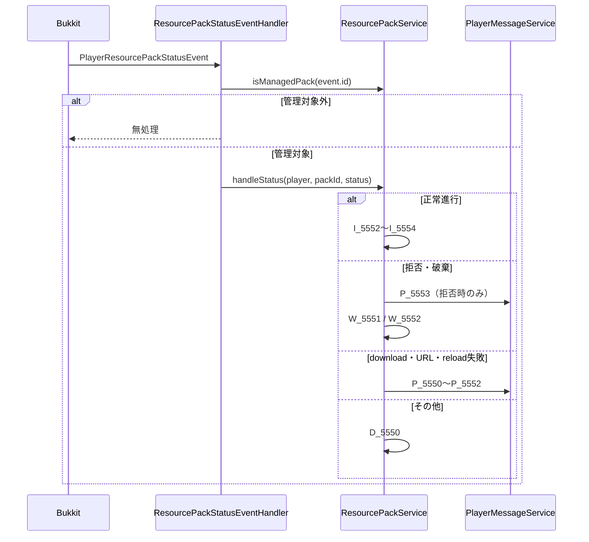

# 30_4-統合フロー

## 1. 参加時のリソースパック要求

### シーケンス

### 処理要点

1. ハンドラの登録自体が `isEnabled` により制御される。
2. マニフェスト取得待ちを同時参加者間で共有し、参加接続が有効な場合だけメインスレッドで送る。
3. 管理配布の対象外や取得失敗時は固定URL方式の設定を確認する。固定URL方式のSHA-1不正時はSHA-1なしで要求する。

## 2. クライアント status の処理

### シーケンス

### 処理要点

1. パックIDを照合する。固定URL方式ではURLが変わると導出UUIDも変わる。
2. 管理配布で成功した接続だけが専用フォントを使用する。配布マニフェストの `java.actionRingPanel` と RPG のスプライト台帳の SHA-256 が一致する場合は、アクションリングの一体型モデルも使用する。GUI背景はさらに `java.guiTheme` が対応する互換版 `"1"` の場合だけ使用し、古いパックや固定URLでは通常のタイトルへフォールバックする。効果音は `java.gameplaySounds` が対応する互換版 `"1"` の場合に専用音を使用し、それ以外の Java 接続では標準音を使う。統合版は Geyser 拡張がログイン時のパックから互換版を確認し、Proxy が現在の接続先へ対応を通知した場合に専用音を使用する。未通知では標準音を使う。適用と互換性の状態は退出時に解除する。

### 例外・終了条件

ハンドラ内例外は `runSafely` が捕捉し、`E_5550` へ集約する。

## 3. 統合版の接続

Geyser Extension は検証した配布パックを接続時に登録する。RPG がダメージ数値の追跡を開始すると、Geyser はパックを利用する接続へ専用モデルを送り、それ以外の接続へ標準の名札を送る。新しい配布パックは次の接続から使用する。

アクションリングの描画には同じ接続が登録したパックのアセットを使う。一体型モデルで表示できるスプライトだけを置き換え、対応アセットがなければ RPG が送る目印、個別アイコン、文字を表示する。
