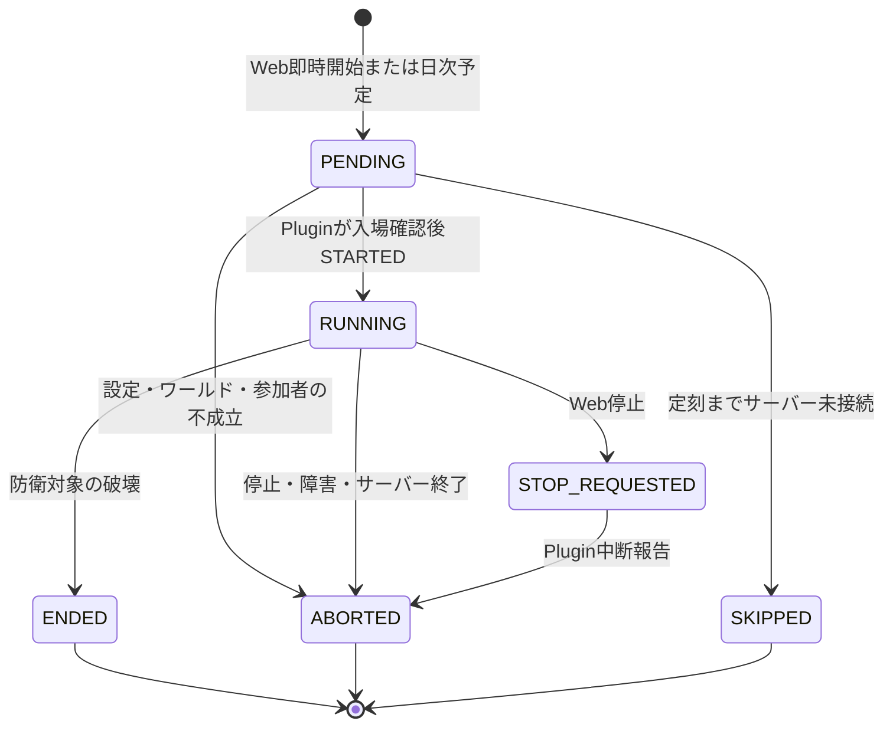

# 42_4-統合フロー

## 開催の状態遷移

`PENDING` はAPIによる開始指示であり、戦闘開始は `STARTED` の報告で確定する。APIの停止要求はruntime取得時に `STOP_REQUESTED` としてPluginへ届く。通常終了は中央破壊による `ENDED`、管理停止・再起動・実行時障害は `ABORTED` と区別する。報告通信が途絶えたrunはAPIが猶予後に中断させ、新しい起動世代が旧戦闘を引き継がない。

## 非同期境界

Webは運営設定をAPIに保存し、APIがチャンネル・JST開催日の一意性と開催状態を管理する。Pluginは約5秒ごとのpollで設定・指示・停止要求を受ける。ゲーム状態の判定、敵生成、死亡、転送完了後の処理はBukkitメインスレッドで行い、HTTPは非同期で実行する。Plugin報告はローカルoutboxに保存してからAPIへ送り、APIが開催・段階報酬を永続化する。受領失敗時は同じ `operationId` の本文を再送する。

再起動時はローカルの帰還・outboxを復元し、前回active runには `SERVER_RESTARTED` のABORTEDを積む。帰還前のプレイヤーが再接続したら保存先へ戻す。防衛戦タグ付きの残存実体を回収するが、前回戦闘の敵・防衛対象・防衛レベルは復元しない。