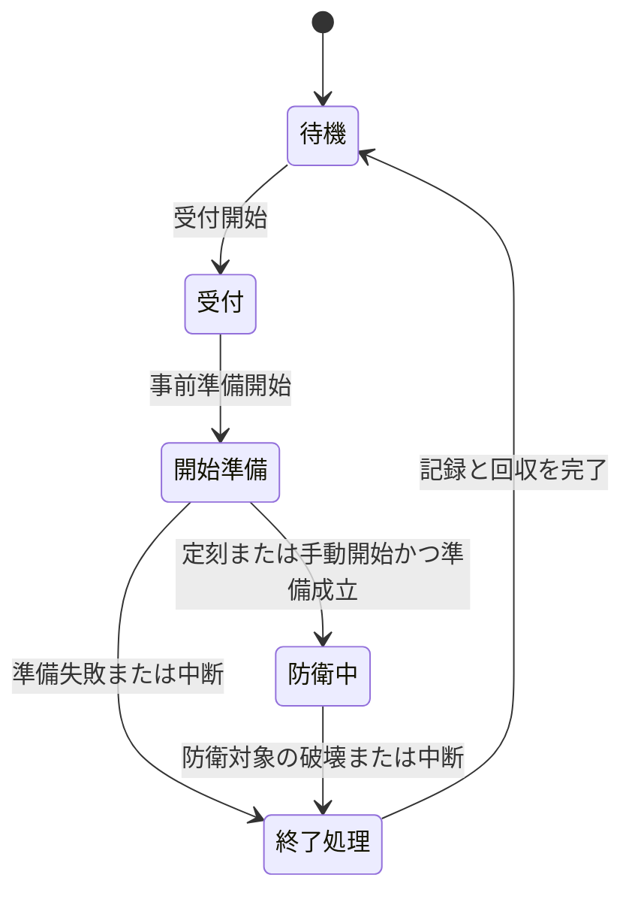

# 42_8-防衛戦の実装予定

## 1. 状態と採用範囲

本書は採用した機能方針を記す未実装の設計である。現在利用できる機能の説明ではない。調整用の数値と未確定の仕様は [[42_9-未決事項]] を正本とし、そこで判断されるまで実装可能な完成仕様とは扱わない。

| 項目 | 採用方針 |
|:--|:--|
| 開催単位 | 各ゲームチャンネルが独立した防衛戦ワールドと開催状態を持つ |
| 開始方法 | Webでチャンネルごとの毎日の開始時刻を設定でき、手動で今すぐ開始することもできる |
| 戦闘形式 | 中央の防衛対象が破壊されるまで続く耐久戦。時間経過によるクリアは設けない |
| 敵 | 防衛戦専用の敵マスタを作らず、参加可とした既存Mobを使う |
| 成長 | 時間経過で防衛レベルが上昇し、近い登録レベルのMobをランダムに多数召喚する |
| 敵の標的 | 防衛対象を優先し、攻撃してきたプレイヤーにも反撃する |
| 参加人数 | 最大30人を設計目標とする。1～10人の出現量・能力は同条件とし、11人目以降で両方を増やす |
| 参加の確定 | 開始時の参加者だけが戦う。真の途中参加は認めず、切断からの復帰だけを認める |
| 死亡と脱落 | 個人ごとの死亡回数に上限を設け、所定の回数に到達すると当該開催から脱落する |
| 報酬 | オーブを開催ごとに得られる。別チャンネルの後続開催にも参加でき、全チャンネル共通の日次受取制限は設けない |

30人という設計目標はサーバー性能の保証ではない。人数、召喚量、同時生存数を合わせた実機検証を必要とする。

## 2. 開催予定とWeb管理

### 2.1 チャンネルごとの設定

開始時刻は日本時間（Asia/Tokyo）の毎日時刻として入力・表示する。チャンネル表示名ではなく、既存ネットワークのチャンネル識別子と実際の実行サーバーを対応付ける。同一チャンネルの別名表示を別開催として扱わない。

| 表示名の例 | 日次開始時刻の例 | 手動操作 |
|:--|:--|:--|
| チャンネルH | 08:00 | 今すぐ開始 |
| チャンネル2 | 09:00 | 今すぐ開始 |
| チャンネル3 | 10:00 | 今すぐ開始 |

上表は運用例であり、実在チャンネルの固定IDや本番設定ではない。チャンネルごとに日次開催の有効・無効を保持する。管理画面には設定時刻、次回予定、稼働状態、受付状態、現在の開催、直近の結果と開始できなかった理由を表示する。

定期開催の時刻は戦闘開始時刻とする。受付、入場確認、参加者確定を含む開始準備は定刻前に行い、準備が成立した開催を定刻に防衛中へ移す。「今すぐ開始」は現在受付済みの参加者を使う。受付が存在しない場合・参加者がいない場合に、無人の戦闘や新しい参加者の途中加入を発生させない。受付の開閉と告知・手動開始の操作手順、定刻までに開始準備が成立しない場合の対応は `D-06` で判断する。

### 2.2 重複・停止・変更

- 一つのチャンネルで、開始準備・戦闘・終了処理中の開催は最大一つとする。別チャンネルの開催は互いに独立する。
- 前回の耐久戦が続いている場合、次回の定期開催は重ねず、進行中を理由にスキップして記録する。
- 実行サーバーが停止中の場合、その定刻分はスキップして記録する。復帰後に過去の予定を遡って突然開始しない。
- 定期開催はチャンネル・日本時間の開催日で重複を防ぎ、時刻設定の変更で同日分を再発行しない。手動開催は別の操作として識別し、定期開催の消化状態とは分ける。
- 同じ手動操作の連打・通信再送を同じ開催として扱う。手動開始を繰り返しても日次設定を書き換えない。
- 設定変更は未確定の次回予定から反映し、開始済みの開催を変更しない。時刻変更・有効化の当日適用境界と、チャンネルID変更・削除時の移行は `D-07` で判断する。

運営設定の保存と開始指示はWebの管理者権限・本人確認の境界に従い、APIも要求ごとに権限と競合を検証する。Webから任意のサーバーコマンドを実行する仕組みにはしない。

## 3. ワールド、参加者、終了

### 3.1 ワールドと開催の単位

各チャンネルが所有する防衛戦ワールドを用意する。共通のマップを採用しても、ワールド実体、防衛対象、敵、参加者、時間、報酬は共有しない。

開始前に防衛対象の位置、プレイヤーの安全な入場地点、敵の召喚地点と中央までの進軍経路を検証する。終了後は当該開催が作成した敵・防衛対象・表示・処理を回収し、次回用の初期状態へ戻す。専用ワールドの地形破壊・設置・通常スポーンの制御、初期化方式は `D-08` で判断する。

### 3.2 参加の確定と切断復帰

開始前の参加確認・入場が成立した参加者を確定し、その人数を開催中の人数補正の基準にする。入場できなかった人を戦力人数へ数えたまま開始しない。確定後の新規参加や別人への枠の譲渡は認めない。

切断しても本人の参加資格、死亡回数、脱落状態、確定報酬をリセットしない。同じ開催の本人が復帰できる条件と猶予を `D-09` で決める。死亡上限に到達した脱落者を、再接続で戦闘へ戻さない。

死亡回数は個人ごとに数える。脱落前の死亡では待機後に安全地点から復活し、脱落後は戦闘に関与させない。死亡回数・待機秒数は `D-02` の仮置き値を参照する。死亡を取り消す蘇生スキルとの関係は同項で判断する。

### 3.3 終了と障害

主たる終了条件は防衛対象の破壊である。運営による中断や障害は通常の敗北と区別して記録する。全員脱落・退出・切断時の終了判定は `D-10` で判断する。



初期方針ではサーバー再起動後に戦闘を再開せず、中断として扱う。保存済みの報酬は残し、古い開催が進行中のまま残って次回を永久に塞がないよう、実行サーバーの起動世代と開催状態を照合する。正常終了・中断・再起動のいずれでも、終了後の古い通信応答から敵生成や再入場を再開しない。

## 4. Mob選出と防衛対象への進軍

### 4.1 参加可否と登録レベル

Mobマスタに防衛戦の参加可否を持たせ、未指定時の既定値はfalseとする。仮のキー名は次のとおりであり、既存スキーマに追加済みという意味ではない。

```yaml
# 将来の追加候補。現在のMob YAMLへはまだ追加しない。
defenseEligible: false
```

trueのMobから登録済みの「Mob ID・レベル」の組を集め、重複する同一組を除く。現在の防衛レベルとの差の絶対値が最小の組を全て候補にし、その候補から各召喚ごとに等確率で抽選する。同距離の上下レベルは両方含める。この抽選単位では、一つのMobが上下両方の登録レベルを持つ場合、別の組として候補に入る。

任意の未登録レベルを既存召喚処理へ渡して補完させない。有効候補が一つもない場合は開始を成立させず、運営へ設定不足を示す。NPC・Boss等を参加可にできるか、登録レベルごとの参加可否を設けるかは `D-05` の判断対象である。

開催中のマスタ再読込で候補・能力・報酬条件が途中から変わらないよう、開催で採用した定義の世代を固定する方針とする。固定する範囲と不正・削除マスタへの運用対応は `D-05` で決める。

### 4.2 標的と攻撃

防衛戦に属する召喚個体だけへ、防衛対象への進軍と反撃の規則を適用する。通常フィールドの同じMobの敵対性、脅威表、帰還行動を変更しない。

普段は反撃時だけ敵対するグラスボア等も、防衛戦では中央へ進軍して防衛対象を攻撃する。攻撃してきたプレイヤーへ一時的に反撃し、反撃条件が切れたら進軍へ戻す。反撃距離・継続時間・挑発との関係は `D-03` で判断する。

初期方針では、防衛対象へは通常攻撃でダメージを与え、既存のMobスキルはプレイヤーとの戦闘で使う。非プレイヤーの防衛対象を戦闘処理に追加する必要があり、既存AIに任せるだけで動作するとは扱わない。攻撃を持たないMob、遠隔通常攻撃、ペットによる反撃誘導の扱いは `D-03` / `D-05` の判断を要する。

## 5. 防衛レベルと人数補正

時間による防衛レベル上昇と、開始時人数による補正を別の軸として管理する。防衛レベルは参加プレイヤーの平均レベルから算出せず、経過時間で進める。開始レベル・上昇間隔は `D-01` の仮置き値を参照する。

人数による補正は開始時人数で固定する。同じ経過時間・防衛レベルなら、1～10人では出現量・能力を変えず、11～30人で両方を増やす。切断・死亡・脱落により倍率を下げない。したがって、開始後に人数が減るほど残存参加者の負担が増える。

人数補正の式と比較値は `D-04` を参照する。HP・シールド・与ダメージを補正対象とし、防御力・移動速度・会心率等を一律に増やさない。追加補正を既存のBoss人数補正と重ねない。

防衛レベルと人数倍率の更新を既存の生存個体へ遡及させず、新しく召喚する個体へ反映する。マスタ定義そのものは書き換えない。

既存候補の最高登録レベルを超えた後は最高レベルの候補を用い、防衛戦個体の能力補正で難化を継続させる。具体式は `D-04` で判断する。防衛レベルの表示を既存マスタにないMobレベルと混同しない。

大量召喚には、単位時間の出現量、一度の増援量、毎tickの生成量、同時生存数の上限を設ける。到達した上限を超える敵を後で一括生成するために蓄積しない。基本出現量、間隔、端数処理、上限到達時の進行は `D-11` で判断する。

## 6. オーブ報酬

通常のクリア報酬の代わりに、到達段階ごとに各自の報酬を積み上げる。資格を満たした区間について報酬を確定し、脱落後の区間の報酬は増やさない。敗北や脱落で、それ以前の確定済み報酬を取り消さない。

報酬資格を攻撃量の順位だけで決めず、回復・防御・支援役も対象にする。放置・切断中・復活待機中の区間の扱い、報酬段階の単位は `D-12` で判断する。

防衛戦個体の通常の経験値・ゴールド・素材・共通Lootは停止し、オーブを防衛戦の別報酬として扱う。通常フィールドの同じMobの報酬は維持する。討伐クエストや冒険記録を進めるかは `D-12` の判断対象である。

各開催を一意に識別し、同一開催・本人・報酬段階の重複確定と重複受取を防ぐ。一度確定した抽選結果を再送時に再抽選しない。別開催の受取済み状態を流用せず、チャンネルを移って後続開催へ参加した場合も報酬を得られる。

確定済みの未受取報酬は保存し、持ち物の空き不足や切断だけで失わせない。保存と受取の責務をAPIに集約し、PluginからDBへ直接アクセスしない。オーブの種類・数量・抽選、配送方式、保存境界は `D-13` / `D-14` で具体化する。未保存区間を復元できると約束しない。

## 7. Web・API・Plugin・マスタの分担

| 領域 | 将来担当する責務 | 実装前に同期する設計・定義 |
|:--|:--|:--|
| Web | チャンネル別の日次設定、即時開始、状態・結果表示、管理者操作 | `00_docs/30_WEB設計書/feature/05-network-management/` と防衛戦画面の設計 |
| API | 認可、予定と開催の一意性、指示の発行、開始・終了報告、報酬保存・受取 | `00_docs/20_API設計書/` の防衛戦API、チャンネル管理・プレイヤー保存との契約 |
| Plugin | 専用ワールド、参加者、経過時間、敵生成、AI・戦闘、防衛対象、死亡と回収 | 本 feature とMob・戦闘・ワールド・死亡・挑戦予約の関連設計 |
| DB | 運営設定・開催台帳、参加結果、報酬確定と受取状態 | `00_docs/40_Database設計書/`。DBごとの配置は `D-14` で判断 |
| Filebase | Mob参加可否、開催の共通ルール、オーブ報酬定義 | `00_docs/50_Filebase設計書/`、対応スキーマ、API/Plugin読込、編集サイトのフォーム・検証・既定値 |

開始指示には同一開催を識別する情報を持たせ、Pluginは同じ指示の再送で二重開始しない。APIの要求受付だけをゲーム内の開始成功と見なさず、Pluginの開始・終了・中断報告を区別する。既存のネットワーク稼働情報だけを、防衛戦の進行状態の確定証拠にしない。

設定保存時は既存Web/APIと同じ認可・競合検出の規則を利用する。具体的なAPIパス・DTO・DB定義・マスタキーの正式名は `D-14` で確定し、現行の契約に存在するかのように追加しない。

## 8. 設計確定後の受入条件

以下は将来の実装受入条件であり、本設計書作成時点で実機確認済みという意味ではない。

- チャンネル別の定刻・手動開催が独立し、通信再送、連打、前回継続、停止復帰で二重開催しない。
- 参加者と開始時人数が一度だけ確定し、新規途中参加・脱落後の再接続復帰を拒否する。切断からの本人復帰は確定した規則どおりに成立する。
- 参加可の既存Mobだけが、実在する登録レベルから選ばれる。非敵対Mobも防衛対象へ進軍し、通常フィールドでの挙動は維持される。
- 時間・人数の補正が確定した式と境界に従い、生存個体への遡及や別の人数補正との重複を起こさない。
- 防衛対象への通常攻撃、プレイヤーへの通常攻撃・スキル、死亡・脱落・蘇生の境界を確認できる。
- 敵数の上限、進軍経路、30人時の処理負荷を実機で確認し、許容基準は `D-11` で定める。
- 各開催の確定報酬が保存され、敗北・切断・満杯・再送で消失や重複を起こさない。未保存区間との境界が利用者と運営に分かる。
- 正常終了・中断・再起動で、残存個体・ワールド内の参加者・保留処理を回収し、次回開催を妨げない。
