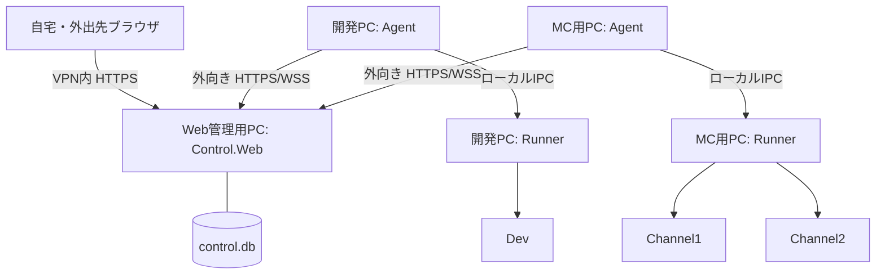

# 01 構成と責務

## 配置



矢印は接続開始方向。接続確立後の指示・応答は双方向。外出先はVPN経由を標準とし、直接公開する場合も管理WebのHTTPSだけを公開する。各Agentから到達できる固定HTTPS URLを用意する。MCゲーム通信のポート設定とは別である。

## リポジトリ配置

```text
30_web/AstralRecordControl/
  AstralRecordControl.slnx
  src/
    AstralRecordControl.Web/        # Razor Pages、HTTP API、SignalR Hub
    AstralRecordControl.Agent/      # PC単位の通信・保守ジョブ
    AstralRecordControl.Runner/     # ゲームプロセス監督
    AstralRecordControl.Contracts/  # DTO、enum、プロトコル検証
    AstralRecordControl.Cli/        # 導入・認証復旧・既存BAT用gate
  tests/
    AstralRecordControl.Contracts.Tests/
    AstralRecordControl.Authentication.Tests/
    AstralRecordControl.Inventory.Tests/
    AstralRecordControl.Agent.Tests/
    AstralRecordControl.Runner.Tests/
    AstralRecordControl.Integration.Tests/
60_tool/control-deploy/             # build/publish/install/update入口
00_docs/30_WEB設計書/AstralRecordControl/
```

このツリーにP0を実装する。既存のAstralRecordWeb/APIのSolution参照や認証DBへの接続は追加しない。ContractsはASP.NET/Windowsサービス/ゲームDBから独立したDTOライブラリとする。Web/Agent/Runnerの具体クラスをContractsに置かない。

## コンポーネント責務

| コンポーネント | 所有する処理・データ | 所有しない処理 |
|---|---|---|
| Web | 管理者Identity、Host/Serverの希望設定、Workflow、中央予約、操作要求、結果投影、画面、通知送信 | Javaの直接起動、共有フォルダへの直接更新 |
| Agent | 設定snapshot適用、操作の永続受理・進捗、ファイル/転送、バックアップ、予約実行、更新、ホスト監視 | Java標準入出力の所有、ブラウザ認証、他PCの直接操作 |
| Runner | 実行設定の最終検証、Session、プロセス/stdio、ログ、ローカル排他・保守hold、実行事実 | Web接続、認証DB、cron、ZIP展開、SQL編集 |
| Cli | 初期導入、Webホスト上のowner復旧、Agent接続設定、BATの予約取得・継承・終了報告、緊急診断 | 任意の遠隔OSシェル、共通gateを迂回する通常起動 |

Webでは`OwnerAuth`、`Inventory`、`OperationDispatch`、`WorkflowCoordinator`、`TransferRelay`、`Notification`、Agentでは`Connection`、`OperationInbox`、`FileService`、`BackupService`、`ScheduleEngine`、Runnerでは`ProcessSupervisor`、`ExecutionJournal`、`ResourceGate`、`LogSpool`を責務境界にする。DIでI/O境界を置き、画面やHubへ実行ロジックを直書きしない。

## サービスとアカウント

| サービス名 | 配置 | 起動方式 |
|---|---|---|
| `AstralRecordControl.Web` | Web管理用PC | KestrelをWindowsサービス化、自動起動 |
| `AstralRecordControl.Agent` | 各MC実行PC | Windowsサービス、自動起動・接続再試行 |
| `AstralRecordControl.Runner` | 各MC実行PC | Windowsサービス、自動起動。Agentより先に起動可能 |

サービス登録・ACL設定は導入時にOS管理者が行う。通常実行は専用の非管理者サービスアカウントとし、必要な配置/データフォルダとnamed pipeだけを許可する。Web/Agent更新はそのサービスだけを停止する。公開Web用IISの停止処理にControlを巻き込まない。

P0の登録ツールは`NT SERVICE\AstralRecordControl.Web|Agent|Runner`の専用仮想サービスアカウントを使用する。配置はProgramFilesのサービス別release、データはProgramDataのサービス別領域とし、対象サービス/SYSTEM/AdministratorsへACLを制限する。Webの鍵とAgent tokenはLocalMachine DPAPIで保護し、OS管理者による停止中CLI/設定とサービス実行を両立する。Webはdata rootの`config.json`を読み、Agent/Runnerもそれぞれのdata rootの`config.json`を読む。各プロセスは`web.lock`または`service.lock`を生存期間保持する。

Runnerのログ出力読取はAgent接続状態から独立させる。Web切断・Agent更新・ログ閲覧者の通信遅延でJavaのstdoutを詰まらせない。Runner更新はそのPCの全管理対象を正常停止した後だけ許可する。

## 保存場所と正本

各PCの`%ProgramData%/AstralRecordControl/`を基点とする。以下は論理配置で、サービスアカウント別にACLを制限する。

| 場所 | 内容・正本 |
|---|---|
| `Web/control.db` | Identity、台帳、Workflow、中央予約、操作要求、Agent結果投影 |
| `Web/keys/` | ASP.NET Data Protection鍵。明示的な保存時保護が必須 |
| `Web/staging/` | 有効期限付き中継ファイル。バックアップの唯一の保管先にはしない |
| `Agent/agent.db` | 受理操作、適用設定、予約実行、転送/バックアップjournal、未送信event |
| `Agent/credentials/` | DPAPI等で保護したAgentトークン |
| `Runner/runner.db` | Session、実行ledger、stateRevision、保守hold、復旧状態 |
| `Runner/logs/{serverId}/` | ローテートしたプロセスログとカーソル索引 |
| 管理者が登録するローカルroot | 実際のMinecraft/Proxy、バックアップ、stage/退避フォルダ |

SQLiteはローカルディスクのみ、WAL＋busy timeout 5秒、単一サービスによる書込を基本とする。相手サービスのDBを直接開かずAPI/IPCを使う。SQLiteファイルをSMB共有して複数PCから開かない。スキーマ移行は各サービスの起動前にbackup→トランザクション適用し、失敗時はサービスを起動しない。

実行事実の正本はRunner、Agent実行の保守事実はAgent、希望設定とPC横断保守はWebである。Web表示の古い投影をRunnerの現在状態より優先しない。03のrevisionとepochで区別する。

## Host/Server登録

導入者が各PCで管理可能なroot、Java/Bedrock実行ファイル、バックアップ保存先をローカル設定へ登録する。Webはその登録IDを選び、任意のホストパスを送って範囲を広げられない。

例: Hostの`hostKey=dev-pc`へServerの`serverKey=dev`、`hostKey=mc-pc`へ`channel1`と`channel2`を割り当てる。GuidのIDと表示用key、既存Pluginの`runtimeServerId`は別の項目とする。稼働中のHost移動は禁止し、移送/複製Workflowを使う。

Server設定の作成・更新はWebの希望revision保存→Agent検証→Runnerの実行設定保存→ACKの順。実行設定が適用済みになるまで起動できない。Java、root、引数、ポート、停止コマンドの変更は停止中のみ反映する。表示名・ログ保持など非実行設定は稼働中にも適用可能とし、現在Sessionの設定版を変更しない。

## 障害境界

| 障害 | 継続するもの | 制限・復旧 |
|---|---|---|
| ゲーム/API/SQL停止 | Controlログイン、Agent通信、基本起動停止・ログ | ゲーム内管理とruntime ready情報は確認不能 |
| Web停止 | Java、ログ、Agentに適用済みのローカル予約 | 新規遠隔操作・複数PC保守は停止 |
| Agent停止 | Runner、Java、ローカルログ | 保守処理はjournalから再照合。新規予約実行は停止 |
| Runner異常停止 | 生存Javaが残る場合がある | stdioをPIDから復元しない。`Unmanaged`として起動を拒否 |
| Host電源OFF | 他Host、Web | `Offline`。古い操作を復帰時に勝手に実行しない |

Runnerでは通常運用の方針として`KILL_ON_JOB_CLOSE`で全Javaを無条件終了させない。異常終了で残ったJavaはPID・生成時刻・実行パス・起動時登録情報を照合する。終了操作の前に再照合し、同一性を証明できなければ自動終了しない。04の復旧手順で管理下へ戻す。
